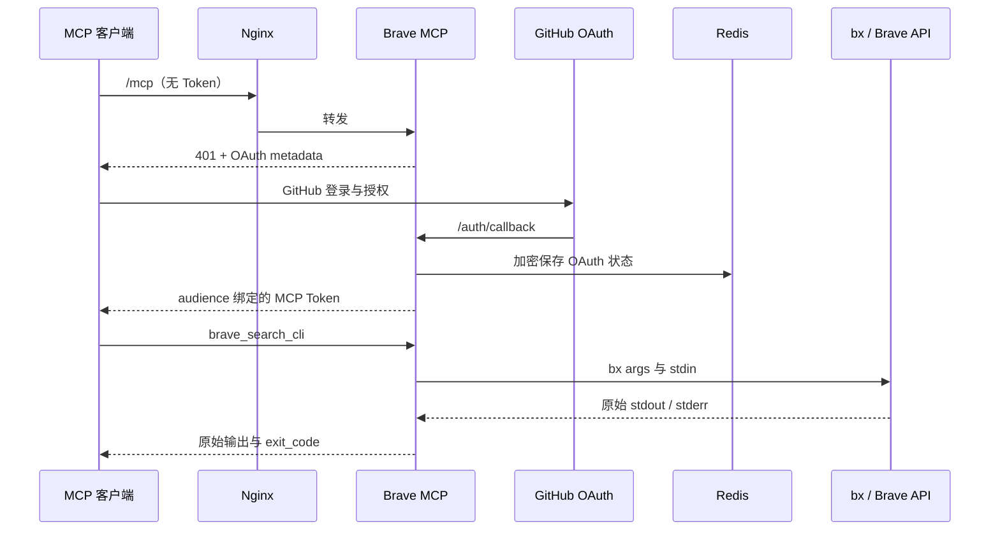

# 配置与运维

部署入口：[统一 Linux 部署运行手册](../DEPLOYMENT.md)。首次部署与升级以该手册为准；本文保留服务配置、工具边界和客户端参考。

## 1. 架构



Nginx 代理所有路径。`/mcp`、`/.well-known/*`、`/auth/callback` 和 OAuth 的 DCR/CIMD 路径不能只代理部分 location。

## 2. GitHub OAuth App

按 [统一部署手册第 3 节](../DEPLOYMENT.md)创建独立 App，Homepage 使用当前公开 origin，callback 为该 origin 下的 `/auth/callback`。服务请求 `read:user`，登录后按 `BRAVE_MCP_GITHUB_USERS` 检查 GitHub login。

## 3. 环境文件

把 `.env.example` 复制为 `/etc/brave-search-mcp.env`，权限设为 0600。把 `.redis.env.example` 复制为 `/etc/brave-search-mcp.redis.env`，只保留同一份 `BRAVE_MCP_REDIS_PASSWORD`。Redis 容器不接收 GitHub 或 Brave 密钥。两个文件都不进入 Git、镜像或日志。

| 变量 | 用途 | 生成或来源 |
|---|---|---|
| `BRAVE_MCP_BASE_URL` | 公开 HTTPS origin | 部署前替换为实际域名，如 `https://{your-domain}` |
| `BRAVE_MCP_GITHUB_CLIENT_ID` | GitHub OAuth App ID | GitHub 开发者设置 |
| `BRAVE_MCP_GITHUB_CLIENT_SECRET` | GitHub OAuth App Secret | GitHub 开发者设置 |
| `BRAVE_MCP_GITHUB_USERS` | 允许访问的 GitHub login | 逗号分隔，不区分大小写 |
| `BRAVE_MCP_JWT_SIGNING_KEY` | MCP OAuth JWT 签名密钥 | `openssl rand -hex 32` |
| `BRAVE_MCP_STORAGE_KEY` | Redis 中 OAuth 内容的 Fernet 密钥 | `openssl rand -base64 32 \| tr '+/' '-_'` |
| `BRAVE_MCP_REDIS_PASSWORD` | 内部 Redis 密码 | `openssl rand -hex 32` |
| `BRAVE_SEARCH_API_KEY` | Brave Search API Key | Brave API Dashboard |
| `BRAVE_MCP_MAX_CONCURRENCY` | 可选，同时运行的 bx 子进程上限，默认 16 | 只在同步调大 compose 的 `mem_limit` / `pids_limit` 后才提高 |

签名密钥或存储密钥轮换会使现有 OAuth 会话失效；先通知用户，再轮换并重启 Compose。Redis 卷保存加密状态，备份时同时保管这两个密钥，否则无法恢复。

`BRAVE_SEARCH_API_KEY` 缺失或 `bx` 不在 PATH 时，进程**启动即失败**并打印原因，不会带着一个每次调用都报错的服务通过健康检查（健康检查只探测端口）。

## 4. CLI 透传规则

工具名为 `brave_search_cli(args, stdin?)`。`args` 是 `bx` 后的参数列表，不能传入 shell 字符串。

`args[0]` 必须是子命令，且只允许 `web`、`news`、`images`、`videos` 四个；这是当前服务代码的固定白名单；此外只接受形如 `["--help"]`、`["--version"]` 的纯标志调用。标志放在子命令之后，保持校验器与 CLI 的命令位置一致。裸查询 `["关键词"]` 也会被拒，因为 bx 会把它路由到不可用的 `context`。

被拒绝的还有 `config`、`--api-key`、`--config`、`--base-url` 和本地 `--goggles @文件`：它们会修改服务器配置、替换服务端凭据或读取容器内文件。`--goggles @-`（stdin）和 HTTPS Goggles 仍然可用。

单次调用最多 128 个参数、stdin 1 MiB，超时 180 秒。stdout/stderr 超过 10 MiB 时**截断保留**并附带 `truncated`、`original_bytes`、`hint` 字段，不再整体丢弃。CLI 的非零退出码照常返回；只有 MCP 输入边界、缺少二进制和并发满载会成为 MCP 工具错误。

并发上限为 `BRAVE_MCP_MAX_CONCURRENCY`（默认 16）个同时运行的 bx 进程，超出的调用排队最多 5 秒，之后返回 `server is at capacity`——该错误表示**本次没有执行任何请求**，可安全重试。这个上限管的是子进程数（内存和 pid 的实际消耗方），不是请求数：FastMCP 的工作线程池仍会接纳 40 个并发调用，它们在这里排队。

## 5. Ubuntu／Debian 部署与 TLS

执行 [统一部署运行手册](../DEPLOYMENT.md)，端口为 8766。首次安装用 `scripts/prepare-cli.sh` 选择官方最新稳定版；已安装后保留本机 `deploy/brave-cli.version`。明确升级使用 `sudo scripts/update-cli.sh`，保持摘要验证及失败回滚。

## 6. 客户端连接

Codex：

```toml
[mcp_servers.brave-search]
url = "https://{your-domain}/mcp"
```

Claude Code：

```bash
claude mcp add --transport http brave-search https://{your-domain}/mcp
```

ChatGPT、Claude.ai 或 Claude Desktop 使用其远程 Connector 界面添加相同 URL 并完成 GitHub OAuth。不要把远程 HTTP MCP 填入只支持本地 stdio 服务器的配置文件。

WorkBuddy Custom MCP 使用固定回调 URI `workbuddy://workbuddy/mcp/custom-mcp%3Abrave-search/oauth/callback`；服务已将该精确 URI 加入 OAuth 白名单。

Grok 自定义连接器使用固定回调 URI `https://grok.com/connectors-oauth-exchange-code/`；服务已将该精确 URI（包括末尾 `/`）加入 OAuth 白名单。

Gemini 网页版自定义 MCP 同样填写公开 HTTPS `/mcp` 地址，并完成 GitHub 授权。回调范围和排查步骤见[运行手册的 Gemini 接入说明](../DEPLOYMENT.md#61-gemini-网页版)。

## 7. 故障处理

| 现象 | 检查项 |
|---|---|
| `/mcp` 返回 401 | 正常的 OAuth 起点；确认 metadata URL 可访问 |
| GitHub 回调 404 | OAuth App callback、`BRAVE_MCP_BASE_URL`、Nginx 全路径代理必须完全一致 |
| 登录后被拒绝 | 检查 `BRAVE_MCP_GITHUB_USERS` 的 GitHub login，而非显示名或邮箱 |
| 重启后要求重新登录 | 检查 Redis 健康、持久卷、JWT 密钥和存储密钥是否改变 |
| bx 返回 3/4/5 | 分别检查 Brave API Key/套餐、限流和网络；MCP 会保留 bx 的 stderr |
| 容器反复重启且日志第一条是 `missing required environment variable` 或 `bx is not installed` | 启动前置检查失败。补齐 env 文件或镜像里的 bx，不要靠健康检查发现——它只探测端口 |
| `server is at capacity` | 并发子进程已满（`BRAVE_MCP_MAX_CONCURRENCY`，默认 16）。**本次没有执行任何请求**，直接重试即可 |
| 首次连接时 `/register` 返回 429 | nginx 对 DCR 注册端点限流（每 IP 10 次/分，可突发 6 次）。正常客户端每次安装只注册一次；等一分钟重试。多人同时从同一出口 IP 首次接入才可能撞上，需要时调大 `deploy/*.nginx.conf` 里的 `rate` |
| `args[0] must be ...` / 命令被拒 | 标志不能放在子命令前面；`context`/`answers`/`places`/`suggest`/`spellcheck` 不在当前服务白名单内 |
| 502 | `docker compose ps`、`docker compose logs mcp`、Nginx error log 和宿主机 8766 监听状态 |
