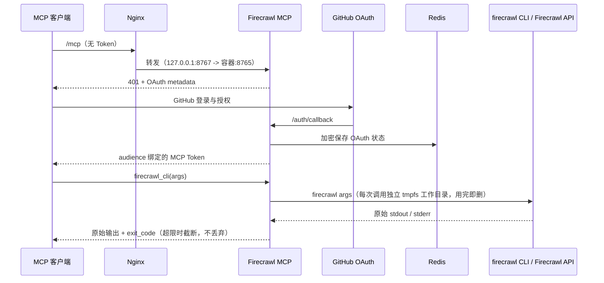

# 配置与运维

部署入口：[统一 Linux 部署运行手册](../DEPLOYMENT.md)。首次部署与升级以该手册为准；本文保留服务配置、工具边界和客户端参考。

## 1. 架构



Nginx 代理所有路径。`/mcp`、`/.well-known/*`、`/auth/callback` 和 OAuth 的 DCR/CIMD 路径不能只代理部分 location。

## 2. GitHub OAuth App

按 [统一部署手册第 3 节](../DEPLOYMENT.md)创建独立 App，Homepage 使用当前公开 origin，callback 为该 origin 下的 `/auth/callback`。服务请求 `read:user`，登录后按 `FIRECRAWL_MCP_GITHUB_USERS` 检查 GitHub login。

## 3. 环境文件

把 `.env.example` 复制为 `/etc/firecrawl-mcp.env`，权限 0600。把 `.redis.env.example` 复制为 `/etc/firecrawl-mcp.redis.env`，只保留同一份 `FIRECRAWL_MCP_REDIS_PASSWORD`。Redis 容器不接收 GitHub 或 Firecrawl 密钥。两个文件都不进入 Git、镜像或日志。

| 变量 | 用途 | 生成或来源 | 改动后果 |
|---|---|---|---|
| `FIRECRAWL_MCP_BASE_URL` | 公开 HTTPS origin | 部署前替换为实际域名，如 `https://{your-domain}` | 改了要同步 nginx/OAuth App |
| `FIRECRAWL_MCP_GITHUB_CLIENT_ID` / `_SECRET` | GitHub OAuth App | GitHub 开发者设置 | 换 App 后所有会话失效 |
| `FIRECRAWL_MCP_GITHUB_USERS` | 允许访问的 GitHub login，逗号分隔，不区分大小写 | 自定 | 重建容器后生效 |
| `FIRECRAWL_MCP_JWT_SIGNING_KEY` | MCP OAuth JWT 签名密钥 | `openssl rand -hex 32` | 轮换后**所有会话失效**，需重新授权 |
| `FIRECRAWL_MCP_STORAGE_KEY` | Redis 中 OAuth 内容的 Fernet 密钥 | `openssl rand -base64 32 \| tr '+/' '-_'` | 轮换后**所有会话失效**；备份 Redis 卷时必须同时备份这个密钥，否则无法解密恢复 |
| `FIRECRAWL_MCP_REDIS_PASSWORD` | 内部 Redis 密码，两个 env 文件都要有且必须相同 | `openssl rand -hex 32` | 两边不一致会导致 MCP 容器连不上 Redis |
| `FIRECRAWL_API_KEY` | Firecrawl API Key | [firecrawl.dev API Keys](https://www.firecrawl.dev/app/api-keys) | 缺失时进程**启动即失败**；失效时每次调用报明确错误，不会静默降级到 keyless 免费额度 |
| `FIRECRAWL_MCP_UPDATE_CHECK` | 可选，设为 `0` 关闭后台版本检测 | 默认开启 | 关闭后 `update_available` 字段永不出现，本地 `--version` 探测也不再执行 |
| `FIRECRAWL_MCP_MAX_CONCURRENCY` | 可选，同时运行的 firecrawl 子进程上限，默认 8 | 自定 | 只在同步调大 compose 的 `mem_limit` / `pids_limit` 后才提高 |

日常 Key 管理使用 `sudo scripts/apikey.sh`（见 §8），也可编辑环境文件后重建容器。

## 4. 命令白名单与被拦参数

工具名 `firecrawl_cli(args, stdin?)`。`args` 是 `firecrawl` 后的参数数组，不能传 shell 字符串。

**允许的命令**：`search`、`scrape`、`map`、`crawl`、`agent`、`research`（含其 `search-papers`/`inspect-paper`/`related-papers`/`read-paper`/`search-github` 子命令）、`credit-usage`；不带子命令时只允许 `--help`/`--version`/`--status`。

命令必须是 `args[0]`，标志放在命令之后，保持校验器与 CLI 的命令位置一致。

**拒绝的命令及理由**：

| 命令 | 理由 |
|---|---|
| `monitor` | 建持久定时任务 + webhook/邮件通知，本 MCP 不开放标准基础设施 |
| `feedback` / `search-feedback` | 回传使用数据到 Firecrawl；服务端也已设置 `FIRECRAWL_NO_SEARCH_FEEDBACK=1`/`FIRECRAWL_NO_ENDPOINT_FEEDBACK=1` |
| `browser` / `launch` / `interact` | 在共享服务器上开持久远程浏览器会话 |
| `download` / `experimental` / `x` | 写本地磁盘 |
| `parse` | 只接受服务器本地文件路径 |
| `config` / `view-config` / `login` / `logout` | 管理本地凭据；服务端已持有 API Key |
| `init` / `setup` / `make` / `env` / `doctor` | 只适用于本地机器 |

**拒绝的参数**（`--flag value` 与 `--flag=value` 两种写法都拦）：`-k/--api-key`、`--api-url`（服务端持凭据）；`-o/--output`（结果走响应的 `stdout` 字段，没有共享文件系统）；`--schema-file`/`--actions-file`/`--scrape-options-file`（改用内联 JSON）；`--webhook`（不开放外发）；`--profile`/`--no-save-changes`（不留持久浏览器登录态）。

**限额**：单次调用最多 128 个参数、每参数 16KiB、stdin 1MiB、stdout/stderr 各 10MiB（超限截断并返回 `truncated: true` + `original_bytes`，不丢弃）、超时 180 秒。CLI 只有 0/1 两个退出码，可操作信息在 stderr 文本里，不在 exit_code 里。

每次调用在独立的 tmpfs 临时目录（`HOME`/`TMPDIR`/`cwd` 均指向它）中运行，调用结束（正常、非零退出或超时）后立即删除，不残留任何 `.firecrawl/` 或凭据缓存文件。

**并发**：同时运行的 firecrawl 子进程上限为 `FIRECRAWL_MCP_MAX_CONCURRENCY`（默认 8），超出的调用排队最多 5 秒，之后返回 `server is at capacity`——该错误表示**本次没有执行任何请求**，可安全重试。这个上限管的是子进程数（内存、pid 和 tmpfs 的实际消耗方），不是请求数：FastMCP 的工作线程池仍会接纳 40 个并发调用，它们在这里排队。默认值配合 `mem_limit: 512m` / `pids_limit: 128` 留了余量，两者要一起调。

## 5. CLI 版本检测

服务端每 6 小时后台异步查一次 GitHub Releases API（无认证，60 次/小时/IP 配额），发现新版本时给该次工具响应加一个 `update_available` 字段，不阻塞、不影响调用结果；查询失败静默重试，不抛出。CLI 自带的更新检查（会打 npm registry、写 `~/.firecrawl`、往 stderr 打通知）已通过 `FIRECRAWL_NO_UPDATE_CHECK=1` 关闭。设 `FIRECRAWL_MCP_UPDATE_CHECK=0` 可整体关闭本服务端的检测（离线部署），包括本地版本探测。

本地已装版本靠一次 `firecrawl --version` 子进程读取，结果进程内缓存，**整个进程生命周期最多跑一次**，冷启动的并发调用也只会触发一次。探测只在已经拿到 GitHub 侧版本号（有可比对象）时才发生；`FIRECRAWL_MCP_UPDATE_CHECK=0` 时完全不跑。探测失败会被记住而非反复重试——代价是该进程此后不再报告 `update_available`，重启即恢复。

看到 `update_available` 后用 `scripts/update-cli.sh` 升级，见 §7。

## 6. Ubuntu／Debian 部署与 TLS

执行 [统一部署运行手册](../DEPLOYMENT.md)，端口为 8767。

## 7. 升级 firecrawl CLI

```bash
sudo scripts/update-cli.sh --dry-run    # 只报告当前/最新版本，不改任何东西
sudo scripts/update-cli.sh              # 升级到最新版本
CLI_VERSION=your-release-version   # 替换为实际目标版本
sudo scripts/update-cli.sh "$CLI_VERSION"
```

首次 `scripts/prepare-cli.sh` 解析官方最新稳定 release 并记录在 `deploy/firecrawl-cli.version`；正常代码重建沿用该版本。显式升级脚本验证 release 资产、更新本机记录、重建并验证版本与健康状态；失败时恢复原记录和原镜像，不改写源码版本。真实业务调用按部署手册验收。

## 8. 管理 Firecrawl API Key

```bash
sudo scripts/apikey.sh show      # 掩码查看当前 key，不泄露完整值
sudo scripts/apikey.sh set       # 交互式输入新 key（隐藏，不进 shell history），校验后写入并重建容器
sudo scripts/apikey.sh verify    # 只校验当前生效的 key，不改任何东西
sudo scripts/apikey.sh delete    # 删除 key；缺少该项的 MCP 进程无法启动
```

`set`/`delete` 之后必须 `docker compose up -d --force-recreate`（脚本已自动做）——`env_file` 只在容器创建时读取，`docker compose restart` 不会重新加载。

## 9. 客户端连接

Codex：

```toml
[mcp_servers.firecrawl]
url = "https://{your-domain}/mcp"
```

Claude Code：

```bash
claude mcp add --transport http firecrawl https://{your-domain}/mcp
```

ChatGPT、Claude.ai 或 Claude Desktop 使用其远程 Connector 界面添加相同 URL 并完成 GitHub OAuth。不要把远程 HTTP MCP 填入只支持本地 stdio 服务器的配置文件。给 agent 的传参规则和边界见 [AGENTS.md](AGENTS.md)。

WorkBuddy Custom MCP 使用固定回调 URI `workbuddy://workbuddy/mcp/custom-mcp%3Afirecrawl/oauth/callback`；服务已将该精确 URI 加入 OAuth 白名单。

Claude、ChatGPT／Codex、Gemini、Antigravity、Grok、Cursor 等客户端的回调由六个服务共用的[客户端回调白名单](../DEPLOYMENT.md#61-客户端回调白名单)统一管理。新增客户端时先在该白名单和 `mcp/tests/test_oauth_clients.py` 中加入它的完整回调集合。

## 10. 故障处理

| 现象 | 检查项 |
|---|---|
| `/mcp` 返回 401 | 正常的 OAuth 起点；确认 metadata URL 可访问 |
| GitHub 回调 404 | OAuth App callback、`FIRECRAWL_MCP_BASE_URL`、Nginx 全路径代理必须完全一致 |
| 登录后被拒绝 | 检查 `FIRECRAWL_MCP_GITHUB_USERS` 的 GitHub login，而非显示名或邮箱 |
| 重启后要求重新登录 | 检查 Redis 健康、持久卷、`FIRECRAWL_MCP_JWT_SIGNING_KEY`/`FIRECRAWL_MCP_STORAGE_KEY` 是否改变 |
| `missing required environment variable: FIRECRAWL_API_KEY` | 容器**启动**时就会报这条并退出（不再是每次调用才报）。用 `scripts/apikey.sh show` 确认 key 是否被删除或 env 文件没挂对；`restart: unless-stopped` 会让它反复重启，`docker compose logs mcp` 看第一条 |
| `server is at capacity` | 并发子进程已满（`FIRECRAWL_MCP_MAX_CONCURRENCY`，默认 8）。**本次没有执行任何请求**，客户端直接重试即可；持续出现说明调用方并发过高或单次 crawl 过慢 |
| 首次连接时 `/register` 返回 429 | nginx 对 DCR 注册端点限流（每 IP 10 次/分，可突发 6 次）。正常客户端每次安装只注册一次；等一分钟重试。多人同时从同一出口 IP 首次接入才可能撞上，需要时调大 `deploy/*.nginx.conf` 里的 `rate` |
| `nginx: [emerg] limit_req_zone "..." is already bound` | 同机多个 MCP 的站点配置用了相同的 zone 名。每个服务必须用自己的 `map` 变量名和 zone 名（各服务正式模板中的独立 zone），否则整台机器上所有站点一起起不来 |
| stderr 出现 401/403 或 "unauthorized" | 服务端 Key 无效或权限不足，`scripts/apikey.sh verify` 排查 |
| stderr 出现 402 或 "credit" | 账号额度用尽，去 Firecrawl 控制台充值/等待重置 |
| stderr 出现 429 或 "rate limit" | 触发限流，客户端退避重试 |
| 502 | `docker compose ps`、`docker compose logs mcp`、Nginx error log 和宿主机 8767 监听状态 |

## 11. 同机共存

统一检查项、端口及限流区名称见 [部署运行手册](../DEPLOYMENT.md)。部署后回归同机已有服务的连接与工具调用。
